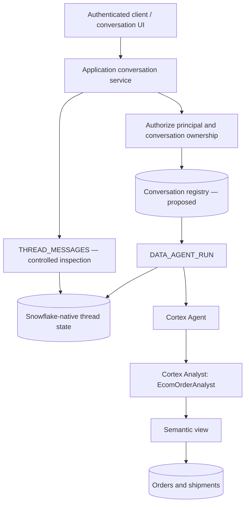

# ADR-002: Snowflake-Native Conversation State for Cortex Agents

| Attribute | Value |
|---|---|
| Status | **Accepted for P2 prototype; production controls pending** |
| Date | 2026-10-13 |
| Project | Snowflake Agentic AI Memory Lighthouse |
| Milestone | P2-A — Conversation State Capability Discovery |
| Decision owner | Data & AI Architecture |
| Related milestone | P0 foundation; P1 stateless baseline; P2-B conversation state contract |

## 1. Context and problem

The P1 Cortex Agent baseline demonstrated stateless invocation over synthetic ecommerce order and shipment data. P2 must support multi-turn conversation continuity: a follow-up such as *“Who is the carrier for that order?”* must resolve the referenced order from earlier conversation turns without fabricating context. The design must distinguish **short-term conversation state** from later episodic, semantic, or procedural memory capabilities.

The reference implementation uses:

- Agent: `ECOM_AGENT_MEMORY_DB.AGENTS.ECOM_STATELESS_AGENT`
- Analyst tool: `EcomOrderAnalyst`
- Semantic view: `ECOM_AGENT_MEMORY_DB.AGENTS.ECOM_STATELESS_FULL_SEMANTIC_VIEW`
- Warehouse: `ECOM_AGENT_MEMORY_WH`
- Execution role: `ECOM_AGENT_MEMORY_OWNER`
- Snowflake CLI connection: `CoCo_Oct`

The deterministic test case is Order **7821**, shipment **SHP_7821**, carrier **BlueDart**, weather-related delay, original expected delivery **2026-10-08**, revised ETA **2026-10-12**, shipment state **IN_TRANSIT**.

## 2. Decision

**Use Snowflake-native Cortex Agent threads for P2 short-term conversation state.** Invoke `SNOWFLAKE.CORTEX.DATA_AGENT_RUN` with a native `thread_id` and `parent_message_id` to continue a conversation; use `SNOWFLAKE.CORTEX.THREAD_MESSAGES` for permitted history inspection.

The calling application must maintain an **application conversation registry** mapping an authenticated principal and application conversation identifier to the Snowflake thread identifier and most recent committed assistant message identifier. This registry is an architectural requirement, **not an implemented component** as of this ADR.

Do **not** create a duplicate full-message conversation table merely to implement the demonstrated multi-turn continuity. Reassess that choice if retention, audit, portability, search, or regulatory requirements demand application-controlled storage.

This decision is **accepted for the P2 prototype only**. It does not constitute production approval until the open controls in §8 have been tested.

## 3. Alternatives evaluated

| Option | Mechanism | Observed evidence | Advantages | Limitations / decision |
|---|---|---|---|---|
| A. Explicit message replay | Caller supplies prior messages in each request | P2-A-02.5 PASS: follow-up resolved Order 7821 | Portable and caller-controlled context | Requires history management, payload growth, truncation policy; retain as fallback/testing approach |
| B. Snowflake-native threads | Caller passes `thread_id` and `parent_message_id`; Snowflake maintains thread messages | Four-turn continuity, independent-thread isolation, eight-message retrieval all PASS | No full history replay; built-in thread continuity and retrieval | Lifecycle, ownership, retention, and access controls still need validation; **selected** |
| C. Application-managed conversation message store | Persist complete conversation history in custom Snowflake tables | Not implemented or benchmarked | Potential custom audit, portability, retention, and deterministic replay | Duplicates native history for current P2 goal; **deferred** |

**Interpretation:** Option B is supported by direct functional tests. The relative cost, latency, and long-term operational suitability of the alternatives have **not** been benchmarked.

## 4. Architecture and state boundaries



### Responsibility boundaries

- **Client/application:** Authenticate users, authorize access to application conversation IDs, map each conversation to its native thread, maintain the latest assistant message ID, and handle retries/concurrency.
- **Snowflake Cortex Agent:** Resolve conversational references using native thread context and orchestrate approved tools.
- **Snowflake native thread facility:** Store and return the conversation messages observed in this test. Its documented retention/authorization guarantees are **not inferred** from a successful retrieval.
- **Semantic layer / source tables:** Provide authoritative order and shipment facts. Conversation state is **not** a replacement for querying current business records.

## 5. Execution contract (observed and proposed)

### Initial turn — observed

A new thread was created using `DATA_AGENT_RUN` with `parent_message_id: 0` and `CREATE_THREAD_IF_NOT_PRESENT = TRUE`. The response returned a `thread_id`, `user_message_id`, and `assistant_message_id`.

### Continuation — observed

Subsequent turns supplied:

```json
{
  "thread_id": 89390720,
  "parent_message_id": 22884004381,
  "messages": [
    {
      "role": "user",
      "content": [
        {"type": "text", "text": "Who is the carrier for that order? Verify against shipment records."}
      ]
    }
  ]
}
```

The third function argument was `FALSE` on continuation. The next turn used the **new** assistant message ID as its parent. Each execution returned `status: completed`.

### Application contract — proposed for P2-B

Registry fields should include `application_conversation_id`, `principal_id`, `snowflake_thread_id`, `last_assistant_message_id`, `state`, `created_at`, and `updated_at`. Define the exact key and tenant model in P2-B. Do not trust a client-supplied native thread ID without server-side ownership authorization. Only advance the stored parent ID after a successful completed turn. Handle duplicate submissions, ambiguous failures, and simultaneous turns explicitly.

## 6. Evidence register

### Verified four-turn conversation

| Turn | User intent | User message ID | Assistant message ID | Verified result |
|---|---|---:|---:|---|
| 1 | Why is Order 7821 delayed? | 22884006405 | 22884004381 | Weather-related delay and revised ETA; native thread created |
| 2 | Who is the carrier for *that order*? | 22884006917 | 22884005897 | Resolved 7821; Cortex Analyst queried shipment; BlueDart |
| 3 | What is *its* revised delivery date? | 22884006409 | 22884005901 | 2026-10-12; IN_TRANSIT; one tool result |
| 4 | Summarize *this order* | 22884006921 | 22884005905 | Correct order, carrier, delay, ETA and status; zero new tool results |

All four turns used native thread **89390720**. Follow-up prompts did not include the order number and did not replay prior messages.

### Independent-thread negative test

A fresh invocation using `parent_message_id: 0` and thread creation enabled produced **thread 89390724**. Asked which order had been discussed previously, the agent explicitly stated there was no earlier conversation context and did not invent an order number. **PASS for independent-thread context isolation**, not for cross-principal access control.

### Native history retrieval

`SNOWFLAKE.CORTEX.THREAD_MESSAGES(89390720)` returned an object containing `messages`, an array of **eight** records. All four expected user IDs and four assistant IDs matched. Records appeared in **reverse chronological order** (newest first). Metadata included `role`, `message_id`, `created_on`, `message_payload`, `is_compressed`, and `compression_alg`.

Observed compression: all four assistant messages and one user message were marked `is_compressed = true`, `compression_alg = GZIP`; the remaining three user messages were not compressed. The presence of payload and compression metadata does not establish universal payload decoding support or long-term retention guarantees.

### Local evidence paths

- `evidence/p2/p2a_native_thread_isolation.txt`
- `evidence/p2/p2a_native_thread_message_metadata.txt`
- `p2a_03_native_thread_turn2.sql`
- `p2a_03_native_thread_turn3.sql`
- `p2a_03_native_thread_turn4.sql`
- `p2a_04_native_thread_isolation.sql`
- `p2a_05_native_thread_inspection.sql`
- `p2a_06_native_thread_message_metadata.sql`

These are repository-relative paths from the execution discussion; verify existence and placement before committing. Earlier Turn 1 and explicit-replay scripts should also be linked from the repository evidence index once their exact paths are confirmed.

## 7. Acceptance criteria and outcomes

| Criterion | Outcome |
|---|---|
| Create a native thread | PASS |
| Continue the same thread without replay | PASS |
| Resolve anaphoric order references | PASS |
| Ground a follow-up in the semantic layer | PASS |
| Summarize earlier conversation without re-querying | PASS |
| Create a new thread without leaking prior conversational context | PASS |
| Retrieve all four user and four assistant messages | PASS |
| Enforce cross-user / cross-role thread ownership | NOT TESTED |
| Validate retention, expiry, and deletion | NOT TESTED |
| Validate concurrent writes, retry/idempotency, and branch handling | NOT TESTED |
| Establish token-window truncation/compression behavior | NOT TESTED |
| Benchmark latency and cost against explicit replay | NOT TESTED |

## 8. Risks, controls, and follow-up tests

1. **Authorization / tenancy:** Native thread continuity is not proof of cross-user isolation. Build server-side principal-to-conversation authorization; test another principal attempting to continue or inspect a thread.
2. **Lifecycle and retention:** Verify supported thread retention, expiry, cleanup, and deletion behavior using authoritative Snowflake documentation and experiments before specifying service-level guarantees.
3. **Concurrency:** Two requests could use the same `parent_message_id`. Define serialization, optimistic concurrency, or explicit branching behavior; test before production.
4. **Failure recovery:** A client timeout may occur after a server-side turn succeeds. Define reconciliation from thread history and protect against duplicate submissions.
5. **Payload and data protection:** History can contain tool results and business data. Apply least privilege, avoid logging full payloads, and classify any customer-identifying content.
6. **Grounding and freshness:** Reused context can become stale. Require tool verification for facts that may have changed; the four-turn summary's zero tool calls are acceptable for summarizing *previously discussed* evidence, not for asserting live shipment status.
7. **Evaluation determinism:** Validate absolute dates (`2026-10-12`) rather than relative language such as “today.”
8. **Compression and observability:** Some stored messages are marked GZIP-compressed. Inspect documented decoding support separately; do not treat a string payload as universally plain text.
9. **Portability:** Keep the application conversation contract independent of Snowflake-specific IDs so another memory backend can be adopted if requirements change.

## 9. Consequences

**Positive:** Demonstrated short-term continuity without full-message replay; grounded follow-ups; concise summary from existing context; retrievable message identifiers; less custom history-storage code for P2.

**Tradeoffs:** Application-level ownership and lifecycle remain necessary; native thread behavior introduces platform coupling; retention and authorization are not yet proven; application-side replay may still be required for migration or portability.

## 10. Next milestones

- **P2-B:** Specify and implement the conversation-state contract and minimal authorized registry.
- **P2-C:** Repeat the four-turn scenario through the application contract.
- **P2-D:** Test cross-principal isolation, unauthorized access, and failure handling.
- **P2-E:** Validate context limits, retention, compression, and lifecycle.
- **P2-F:** Automate positive/negative evaluations and capture reproducible evidence.
- **P2-G:** Finalize documentation, evidence index, README status, and Git closure.

## 11. Decision review triggers

Reopen this ADR if Snowflake native-thread behavior or availability changes; if verified retention requirements cannot be met; if multi-tenant authorization cannot be enforced; if auditing or export mandates full-message storage; or if performance/cost tests favor another strategy.

---

**Evidence standard:** “PASS” means the described observation was present in the user's Snowflake CLI output. No claims are made about untested production guarantees.
